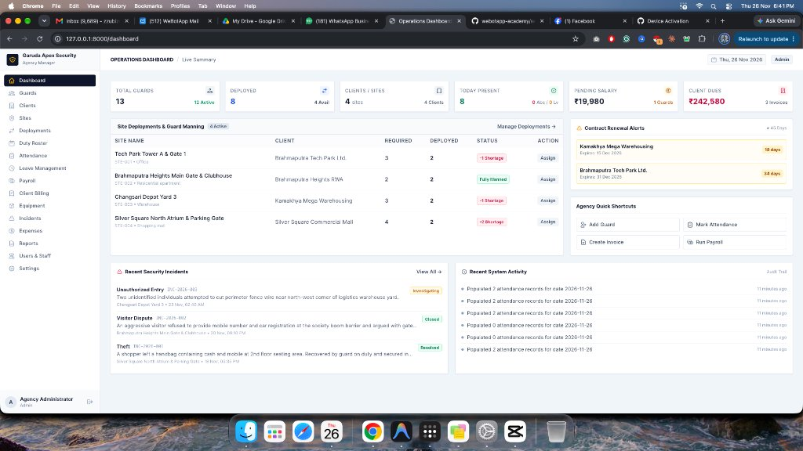
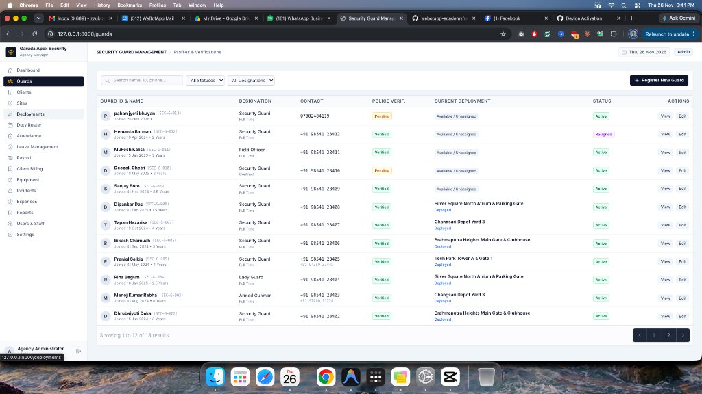
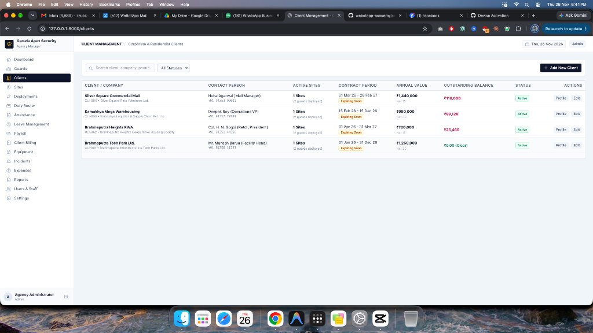
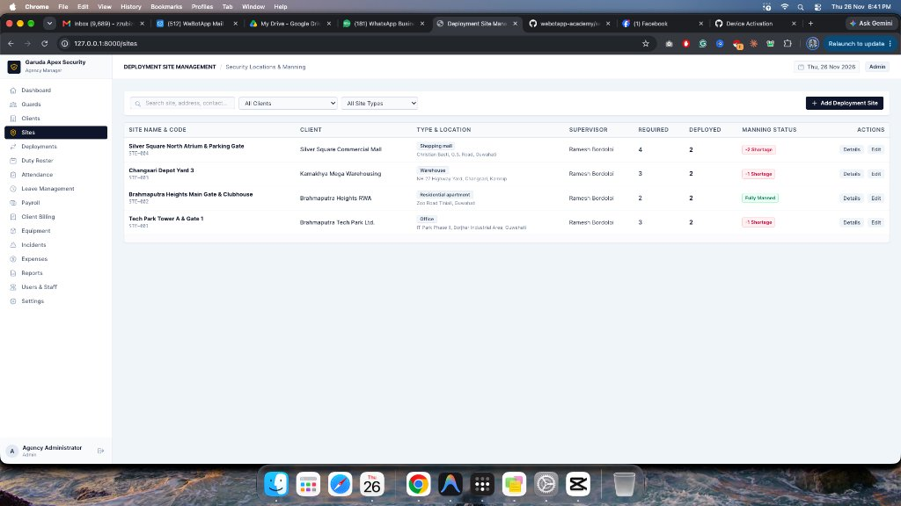

# WeBotApp Security Agency Manager


A complete, compact, production-oriented **Security Agency Management Software** built with **Laravel 13**, **Livewire 4**, **Tailwind CSS 4**, and **MySQL** for Indian private security agencies.

## Screenshots

| Operations Dashboard | Security Guard Management |
| :---: | :---: |
|  |  |

| Client Management | Deployment Sites |
| :---: | :---: |
|  |  |

## Features
- **Dashboard**: Real-time guard counts, deployment status, attendance summary, pending salaries, outstanding invoices, contract renewal alerts, and audit logs.
- **Security Guard Management**: Full guard profiles, auto-generated Guard IDs (`SEC-G-XXX`), Aadhaar/PAN masking, police & background verification tracking, bank details (restricted access), and document management.
- **Client & Site Management**: Corporate/residential clients, GSTIN, contract expiry alerts, multi-site support, required vs. deployed guard tracking.
- **Deployments & Duty Roster**: Non-overlapping active guard deployment enforcement, site transfers, relieving, configurable shifts, daily/weekly duty roster, and printable rosters.
- **Attendance & Leave Management**: Quick bulk attendance, individual time/status corrections with audit trail, monthly muster register, and leave approval workflow.
- **Payroll & Client Billing**: Attendance-linked monthly payroll calculation, salary advances & auto-recovery, printable salary slips, 18% GST (CGST/SGST) client invoicing, partial/full payment receipts.
- **Equipment, Incidents & Expenses**: Uniform/gear stock & issuance, confidential incident reporting, agency operating expense tracking.
- **Reports, Users & Settings**: CSV/Excel & printable PDF reports, role-based access control (Admin, HR Manager, Site Supervisor, Accountant, Operations Manager), and business settings (including customizable Software Logo Name).

## Installation

1. **Clone / Navigate to project**:
   ```bash
   git clone https://github.com/webotapp-academy/security-agency-erp.git
   cd security-agency-erp
   ```
2. **Install dependencies**:
   ```bash
   composer install
   npm install && npm run build
   ```
3. **Configure `.env`**:
   Set `DB_CONNECTION=mysql`, `DB_DATABASE=security_agency_db`, `DB_USERNAME=root`, `DB_PASSWORD=` (or your MySQL credentials).
4. **Run migrations & demo seeder**:
   ```bash
   php artisan migrate --seed
   ```
5. **Start the server**:
   ```bash
   php artisan serve
   ```

## Demo Credentials (Password: `password`)
- **Administrator**: `admin@webotapp.com`
- **HR Manager**: `hr@webotapp.com`
- **Site Supervisor**: `supervisor@webotapp.com`
- **Accountant**: `accounts@webotapp.com`
- **Operations Manager**: `operations@webotapp.com`

## License

This project is licensed under the [MIT License](LICENSE).
